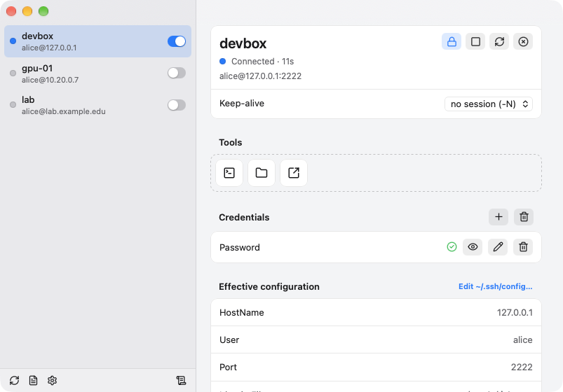

# Shellder

[](https://github.com/Phantom1003/Shellder/actions/workflows/build.yml)

**Shellder keeps your SSH connections warm.** It is a small menu bar app for
macOS and Linux that holds `ssh -M -N` master connections open in the
background, so every later `ssh`, `scp`, `rsync` or VS Code Remote session
reuses the socket and connects instantly, with no password, passphrase or
one-time code to type.

When a master has to be (re)established, Shellder answers the prompts itself
from your keychain, including TOTP codes, and only shows a dialog for things
it cannot answer, such as an unknown host key.



## Why

Servers behind a jump host, a VPN that drops every few hours, a login that
needs a password *and* a 2FA code: every hop costs a prompt, and ControlMaster
only helps while a master is alive. Shellder makes the master a thing the OS
keeps alive for you, reconnects it with back-off when the link drops, and puts
a switch and a lock per host in the menu bar.

## Features

- **Your `~/.ssh/config` is the only configuration.** Shellder lists every
  `Host` block (following `Include`), resolves it with `ssh -G` and never
  writes to the file.
- **One switch per host.** On means "connect": the master stays up as long as
  the connection lasts. Off closes it. A failed login flips the switch back
  instead of hammering the server.
- **A lock per host.** A locked host is reconnected with back-off when the
  link drops and comes back when Shellder starts. Whatever turns the switch
  off clears the lock.
- **A per-host keep-alive mode** for servers that reject session-less
  connections.
- **A console per host.** One click opens a window on what the host is
  doing: load, CPU, memory, GPUs, disks, the busiest processes, and its tmux
  sessions, any of which opens in the window's own terminal, through the
  master when it is up and on a login of its own otherwise, with the prompts
  answered for you either way. A plain shell goes to your terminal
  application.
- **A file browser per host.** The host's directory tree next to your own:
  drag a file from one side to the other and it is copied, with the
  progress underneath; a copy that stopped halfway goes on from where it
  was. Click a column to sort by name, date modified or size. No master
  needed: a host without one is read and written through a single login
  that stays open.
- **Secrets in the keychain**, in a single item, so the keychain asks for
  permission at most once (the login keychain on macOS, the Secret Service
  on Linux).
- **Prompts answered for you.** Every ssh Shellder starts gets its own
  pseudo-terminal, and passwords, key passphrases and TOTP codes are typed
  into it for you. Unknown host keys are shown with their fingerprint for
  you to accept.
- **Starts at login, can run in the background.** Closing the window quits by
  default; switch "Run in background" on and it keeps the connections alive
  instead, with the menu bar icon to bring it back.
- **Also a CLI.** The same binary can list hosts, lock them, show status and
  store secrets from a terminal. Nothing in it reads a secret back out.

## Quick start

Requires macOS 13 or later, or a Linux desktop with webkit2gtk 4.1.
`build.sh` installs whatever else is missing: Rust, the Tauri CLI and, on
Linux, the development packages the build needs (apt, dnf, pacman or
zypper). `./build.sh --deps` does only that.

```bash
git clone https://github.com/Phantom1003/Shellder.git
cd Shellder
./build.sh --install   # macOS: builds build/Shellder.app, copies it to ~/Applications and launches it
./build.sh             # Linux: build/*.deb and build/*.AppImage
```

Prebuilt bundles for every commit are attached to the
[CI runs](https://github.com/Phantom1003/Shellder/actions/workflows/build.yml),
and tagged versions are published under
[Releases](https://github.com/Phantom1003/Shellder/releases).

Then flip the switch next to a host. The first time, Shellder asks for the
password and offers to save it in the keychain. Lock the host and it
reconnects on its own from then on.

```bash
shellder hosts               # Host entries and their ControlPath
shellder lock myserver       # keep this host connected
shellder status              # UP/down per locked host
shellder add-secret myserver password
```

## Documentation

The full manual, covering the switch and the lock, keep-alive modes, how prompts
are answered and matched to hosts, code signing and keychain behaviour, and
isolated testing, is in [docs/manual.md](docs/manual.md).
